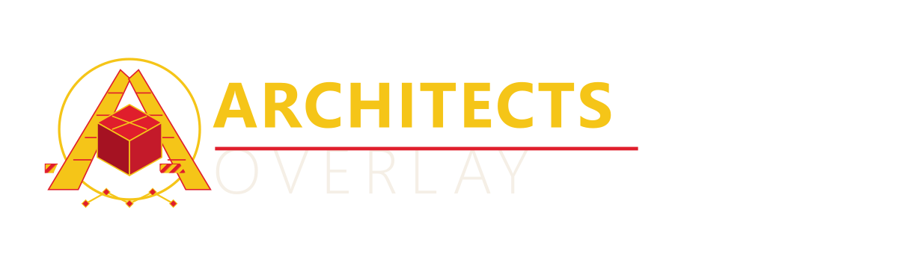

<div align="center">



**Trade overlay for Star Citizen** — prices, marketplace, trade routes and
your hangar as a lean overlay above the game. Built by the community, for
the community.

[Download](https://github.com/SeBoOne/architects-overlay/releases/latest) ·
[Install](#installation) · [License](#license)

</div>

---

## Features

- **Prices & Search** — live commodity prices via UEX, fast in-game search
- **Marketplace** — community listings: browse, sell, buy with deep links
- **Trade Log** — record and track your trades (trkMsg aware)
- **Trade Routes** — best routes between terminals with profit per SCU
- **Inventory & Hangar** — track what you own and where it sits
- **Shortcuts & Hotkeys** — overlay-friendly keybinds, F5-style refresh
- **Auto-Updater** — built-in update check, no telemetry, no tracking

## Installation

### Linux

One-liner (Debian uses `apt`, everything else installs an AppImage to
`~/.local/bin` incl. a desktop entry):

```bash
curl -fsSL https://raw.githubusercontent.com/SeBoOne/architects-overlay/main/scripts/install.sh | bash
```

### Windows

Grab the **Setup.exe** (or the **MSI**) from the
[latest release](https://github.com/SeBoOne/architects-overlay/releases/latest)
and run it — the app ships its own auto-updater afterwards.

> **Integrity:** every release publishes a `SHA256SUMS` asset. Verify your
> download before running it.

## Data Sources & Credits

- Price/marketplace data: **[UEX](https://uexcorp.space)** — thanks to the
  UEX team for the API
- Additional game data: **[Star Citizen Wiki](https://star-citizen.wiki)**
- Star Citizen is a trademark of Cloud Imperium Games. This is a
  **community project, not affiliated with, endorsed by, or sponsored by
  CIG/RSI** in any way.

*Made by the community.*

## Development

This repository is the public mirror; development happens in a private
dev repo (feature branches, kanban workflow). Build gates, architecture and
conventions are documented in
[docs/DEVELOPER.md](docs/DEVELOPER.md).

## License

Released under the [MIT License](LICENSE) — **except the brand assets**: the
emblem, logo and lockup (`brand/`) are **not** covered by the MIT license and
may not be reused outside this project without permission. See the
[Brand and Logo Exclusion](LICENSE#brand-and-logo-exclusion) section in the
license file.
